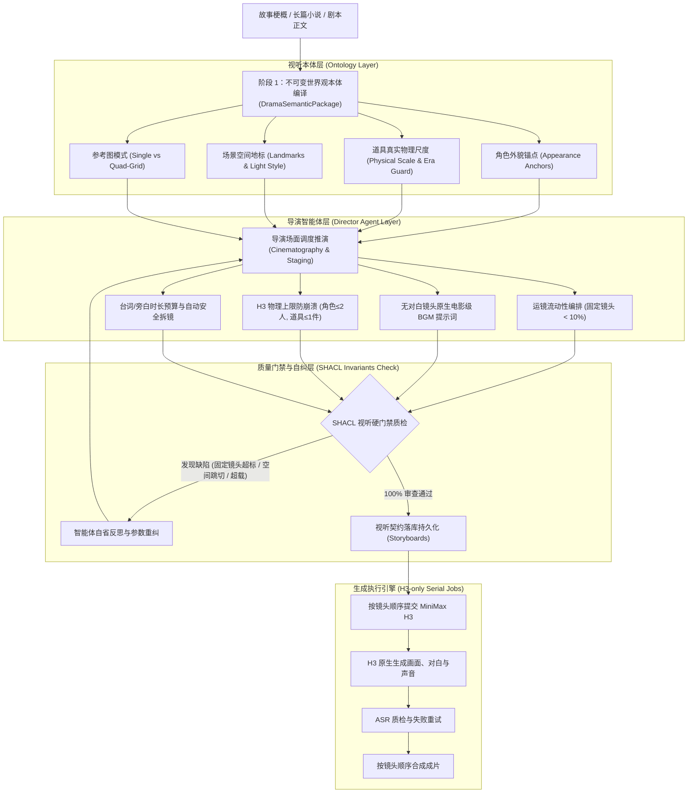

# 影视视听本体与全生命周期导演智能体架构设计规范
*(Audiovisual Drama Ontology & Full-Lifecycle Autonomous Director Agent Architecture)*

> **开源致谢与演进声明**：
> 本架构基于开源项目 [LocalMiniDrama (xuanyustudio)](https://github.com/xuanyustudio/LocalMiniDrama) 演进而来。针对原工具在长文本剧情拆解、多机位运镜流动感、多资产真实物理尺度与世界观连戏一致性等方面的工业级短剧生产痛点，重构并引入了**影视视听本体（Audiovisual Drama Ontology）**与**全生命周期导演智能体（Autonomous Director Agent）**体系。

---

## 一、 背景与核心痛点

在传统的 AI 短剧生成工具中，通常采用简单的“剧本文本 ➔ 提取关键词 ➔ 分割文本 ➔ 逐句生图/生视频”的分步调用流水线。这种模式在实际制作中面临几大系统性痛点：

1. **画面死板、PPT 幻灯片感严重**：缺乏专业导演的机位与运镜设计，生成的分镜提示词多为静态陈述，导致固定镜头（static shot）泛滥；
2. **多模态音频与画面割裂**：传统视频模型生成的无对白镜头缺乏声音氛围，成片全靠后期背景音乐生硬铺底，缺乏电影原声的呼吸与张力；
3. **物理尺度与要素超载崩溃**：MiniMax H3 存在明确的上下文与参考素材物理上限（例如最多 9 张参考素材）。若分镜中同时出现多人或多件道具，模型极易崩坏变形；
4. **资产前后不一致与过时残留**：剧情经过修改后，旧的角色、道具留在库中干扰后续生图；或者同一道具在不同镜头中大小比例失真；
5. **双架构与入口分裂**：随着新功能的迭代，系统若同时存在“单次简单提取”与“智能体推演”两套平行逻辑，极易导致前端按钮冗余重叠、后台调度不一。

---

## 二、 架构总览（三层视听本体体系）



---

## 三、 核心技术设计

### 1. 不可变剧目本体语义包（DramaSemanticPackage）
- **核心理念**：将剧目的所有世界观实体（角色、道具、场景、空间地标、时代约束）编译为一个不可变的上下文契约（Semantic Revision）。
- **道具真实物理尺度**：
  - 强制标注具体物理尺寸（如“长约45cm的手提密码箱”、“高度约75cm的案几”）；
  - 严禁出现与时代穿帮的现代道具，小件道具严格约束为“次要环境小物件，绝不可夸大夺焦”。
- **视图格式槽位约束（Reference Image Mode）**：
  - 核心复杂结构道具/常驻多机位主场景：自动规划为 `quad_grid`（四视图）；
  - 单一视角小道具/一次性过场场景：自动规划为 `single`（单图高画质）。

### 2. 导演场面调度与运镜流动性（Director Agent）
- **运镜铁律**：固定镜头（static）全剧占比严格控制在 10% 以下。
  - 对白与反应镜头：采用微推（push）或微拉（pull）锁定情绪呼吸感；
  - 动作与位移镜头：采用平稳跟拍（tracking）或横摇（pan）；
  - 紧张冲突与对峙：采用手持微晃（handheld）增强真实临场感。
- **电影级原生 BGM 提示词**：
  - 有台词镜头：`bgm_prompt` 设为空，保障人声对白发音清晰无杂音；
  - 无台词纯动作/悬疑/环境镜头：强制生成极具情绪张力的电影原声配乐描述（如“低沉紧迫的战术重低音脉冲与心跳打击乐”），直接赋能 H3 等视频大模型原生合成高质量背景音乐。

### 3. H3 视频生成物理硬约束与智能拆镜
- 针对 MiniMax H3 单镜头最多 9 张参考素材（首尾帧 2 张 + 场景 1 张 + 角色 + 道具）的物理边界：
  - **单镜角色限制**：严格控制在 1～2 人，多人场景主动拆解为正反打镜头序列；
  - **单镜核心道具限制**：严格控制在 1 件（至多 2 件），无交互的背景物件不挂载；
  - **单镜连贯动作弧**：一个镜头可以承载多个紧密相连的动作、对白和反应；只有真实时长、场景、视角或因果关系发生变化时才拆镜。

### 4. H3 模式、声音和连戏
- **默认模式是 Ref2VA**：导演 Agent 为每镜规划角色、场景和道具参考，生产请求使用 H3 官方六段结构：`subject_definitions`、`summary`、`retention_analysis`、`detailed_description`、`overall_soundscape`、`non_diegetic_music`。参考图保持原始多视图文件，不裁切；提示词明确多视图属于同一角色或同一空间，避免把设定板误当成多个主体。
- **FL2VA 是人工覆盖**：只有用户在单镜设置中明确选择 FL2VA 时，系统才要求首帧（可选尾帧）并构造关键帧路径。导演 Agent 不规划 FL2VA、首尾帧生成或自动尾帧接力。
- **H3 原生声音**：对白、旁白、环境声和配乐由 H3 根据提示词与音色参考生成；系统不向 H3 发送完整 TTS 音轨，也不在下载后用 FFmpeg 替换 H3 原生人声。生成后可用 ASR 检查是否漏字或出现额外语音，问题返回本镜重试。
- **连续镜头和 Continuum**：4～8 秒使用普通 H3，9～30 秒使用 Continuum；镜内时间线是因果动作节拍，不等于硬切清单。只有 `shot_change=true` 才写入切镜。H3 任务严格串行提交，后镜只有在前镜完成并需要连戏时才读取上一镜结果。

---

## 四、 两阶段导演流水线

系统在 UI 与后端调度上严格遵循“阶段一剧情骨架、阶段二视听执行合同”的单一导演链路：

```
                    ┌──────────────────────────────────────┐
                    │          故事生成与全局配置          │
                    │  (画幅比例 / 风格 / 语速 / 单镜时长) │
                    └──────────────────┬───────────────────┘
                                       │
                ┌──────────────────────┴──────────────────────┐
                ▼                                             ▼
     【阶段一：剧情分镜骨架】                  【阶段二：视听执行合同】
 🎬 [导演生成分镜脚本]                      🎨 [补充视听槽位 / 单镜微调]
       │                                              │
       ├─ 按原文规划场景、角色、对白、时长             ├─ 读取 SQLite 中本集剧本、资产和连戏状态
       ├─ 控制单镜角色与时长物理上限                   ├─ 由 Agent 完整填写 semantic/video slots
       └─ 骨架通过完整性门禁后入库                     ├─ 视线、动作、口型、音频和参考图一次确定
                                                      ├─ 门禁失败按镜聚合反馈给 Agent
                                                      └─ 通过后落库并进入 H3 串行生成
```

---

## 五、 开发协同守则（已写入 AGENTS.md）

1. **先分析、先确认、后动手**：遇到需求变更、功能调整或 Bug 修复，**严禁直接动手修改代码**。必须先深入分析技术影响与根因，列出清晰的整改方案与用户确认，达成完全共识后方可开始改动代码。
2. **杜绝打补丁与双架构分裂**：重构或新增逻辑时，必须向核心架构收敛，严禁随意保留或新增平行的重复入口与分裂代码。

## 六、两阶段导演流水线的职责边界

阶段一由导演 Agent 生成剧情分镜骨架：对白、旁白、角色与场景关联、时长、基本机位、声音语义和 H3 模式。阶段一落库前不生成执行层的默认视线、姿态、动作或时间线；如果原文覆盖、角色数量、时长或场景边界不成立，阶段一直接失败，不写入不完整分镜。

阶段二仍由导演 Agent 负责完整的执行合同。它读取当前集剧本、全集分镜、相邻连戏镜头和 SQLite 中的本体资产，输出 `semantic_slots`、`character_visuals`、`last_frame_visuals`、`video_slots`、`shots_timeline`、视线目标、动作反应、口型同步和参考素材清单。

本地服务是门禁和编译器：只做 JSON 类型归一化、时间戳格式转换、ID 与参考素材映射、H3 官方提示词六段编译、workflow 参数绑定和任务提交。它不得从对白或动作猜测出场人物、说话人、视线、姿态、动作、时长、拆镜或参考图策略，也不得静默截断角色、台词、参考图或自动修复语义违规。旧的 `sync_v1`、Wan2.2、完整 TTS 音轨和派生 `video_prompt` 不再作为生产链路兼容入口。

门禁失败时按镜头聚合完整违规反馈给执行合同 Agent，连同相邻连戏上下文重新规划整镜；目标镜头和相邻镜头通过后再做整集终检。仍未通过则任务失败且不写入错误的执行合同，页面可通过后台任务记录查看失败原因并重试。
